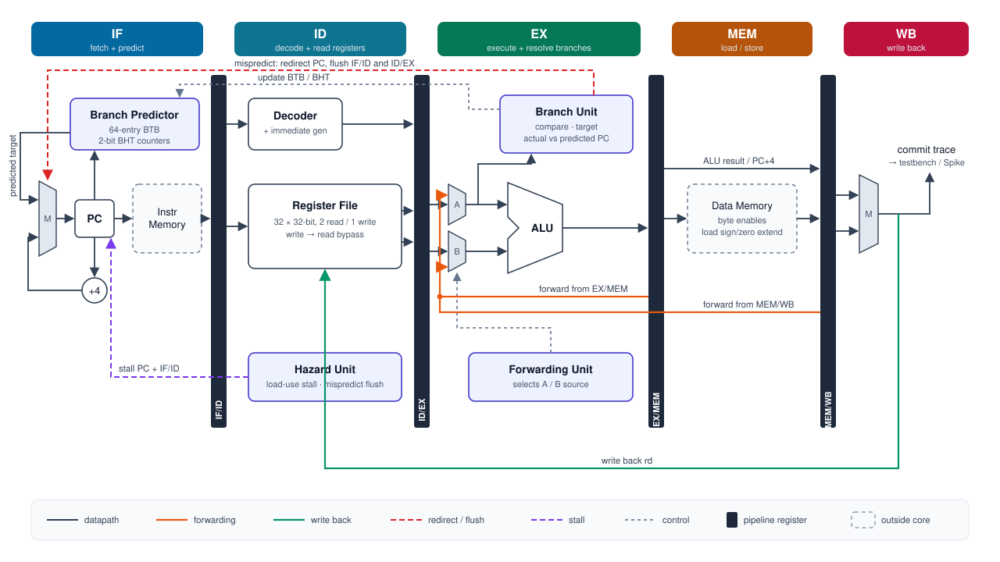
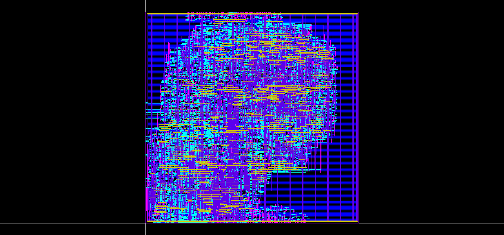
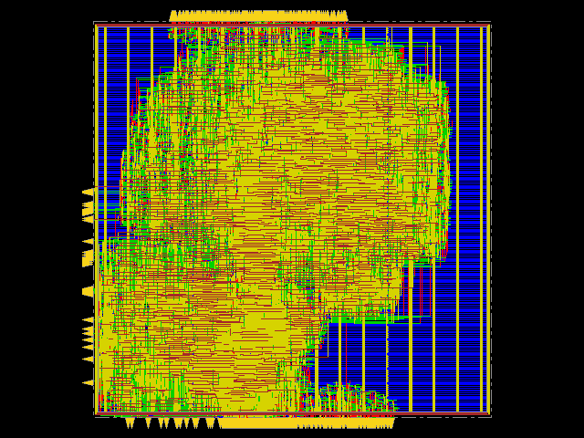

# RV32I 5-stage pipelined core

A 5-stage pipelined RISC-V core (RV32I) that I wrote in SystemVerilog, verified against Spike, and took through synthesis, place and route and sign-off on SkyWater 130 nm with the Cadence tools.

<p align="center"></p>

## Design

The pipeline is the standard IF, ID, EX, MEM, WB. Results are forwarded from EX/MEM and MEM/WB, and the register file passes a value through when it's read in the same cycle it's written. With that, the only stall left is one cycle when an instruction uses the result of the load right before it.

Branches and jumps resolve in EX. To avoid losing two cycles on every taken branch, fetch looks up a 64-entry BTB with 2-bit counters and follows its prediction. A wrong guess flushes the two younger instructions.

On my directed test the CPI is 1.106 with the predictor and 1.639 with it turned off.

## Verification

The testbench logs every instruction that leaves WB in the same format as Spike's commit log, and `scripts/compare.py` compares the two logs instruction by instruction (PC, instruction, register written, store address and data).

- Directed hazard test: 455 instructions, matches Spike
- 11 riscv-dv random tests generated on Xcelium: all pass
- The synthesized netlist and the final routed netlist both run the same test cycle for cycle (502 cycles, CPI 1.106)

## Physical design

SkyWater 130 nm, SCL 9-track standard cells, 50 MHz.

| Step | Tool | Result |
|---|---|---|
| Synthesis | Genus | timing met, 5,820 flops, about 17k cells, 0.39 mm² of cells |
| RTL vs netlist | Conformal LEC | equivalent |
| Place and route | Innovus | 0 DRC, 0 antenna violations, 1.02 x 1.01 mm die |
| Netlist vs routed netlist | Conformal LEC | equivalent |
| Timing sign-off (1.62 V, 125 °C) | Tempus | setup slack +0.33 ns, hold slack +0.16 ns |
| DRC | PVS | metal and via rules clean |
| LVS | PVS | match |

The only DRC errors left are two implant rules (`CDR.psd`) that the library's flip-flop and mux cells fail even on their own. In LVS I left out the antenna diode cells, because the rule deck doesn't extract them as devices.

## Layout

<p align="center">
  
  
</p>


## Running it

```
make test SIMULATOR=xcelium SRC=tests/hazards.S
make regress SIMULATOR=xcelium DV_OUT=~/dv_out

cd pd
make setup
make syn
make lec
make pnr
make lec_pnr
make sta
```

`make test ... GATE=syn` or `GATE=pnr` runs the same test on the gate-level netlist.

## Files

```
rtl/        the core
tb/         testbench
tests/      directed test and linker script
scripts/    Spike log compare, hex conversion
riscv-dv/   random test lists
pd/         synthesis, place and route, timing and LEC scripts
```
